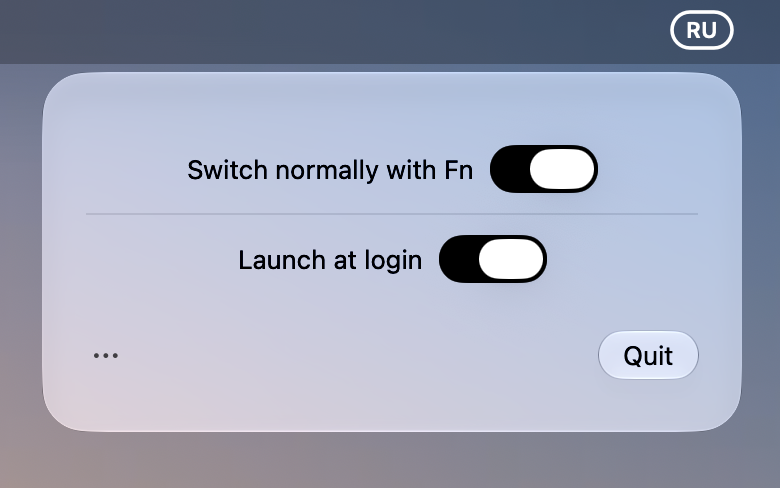

<table>
  <tr>
    <td width="116"></td>
    <td><h1>Normal Switcher</h1><p>Language switching that feels normal.<br>A small, native macOS menu bar app by Matthew Avgul.</p></td>
  </tr>
</table>

<p align="center">
  
</p>

Normal Switcher changes your keyboard language with a tap of **Fn / 🌐**, using direct input-source selection. It keeps the controls small: two switches, an about menu, and a Quit button.

## Features

- **Switch normally with Fn.** One tap chooses one destination. The destination is fixed on key-down and selected on release, so duplicate events cannot toggle straight back.
- **Keep Fn shortcuts.** Fn + Delete, arrow keys, media keys, and other combinations stay combinations.
- **Your languages.** The menu bar displays the current input source’s language code, such as EN, RU, FR, or DE, from the sources enabled in macOS.
- **Two badge styles.** ASCII-capable layouts use a solid capsule; other layouts use a transparent capsule with a strong outline. EN is filled and RU is outlined.
- **A native panel.** Liquid Glass, monochrome controls, automatic light/dark appearance, and a compact panel positioned below the menu bar. Click the badge again, press Escape, or click outside to close it.
- **Launch at login.** Uses the macOS `SMAppService` API and reflects the system’s registration state. It stays off until you enable it.
- **Reversible Fn control.** Disabling the function restores your previous Fn action. Normal exit restores it too, and a saved recovery record handles an interrupted run at the next launch.
- **Local operation.** No account, telemetry, text logging, or background network service.

## Install

**Requirements:** macOS 26 or later and an Apple Silicon Mac.

1. Download `Normal-Switcher-1.0.4-macOS.zip` from the [latest release](https://github.com/maaatheeew/Normal-Switcher/releases/latest).
2. Move **Normal Switcher.app** to **Applications** and open it.
3. Quit any other utility that remaps Fn, then enable **Switch normally with Fn**.
4. Use the centered **Allow access** button to approve Accessibility access in macOS. In macOS 27, the permission is called **Device Control and Data Access**.

Until access is granted, Normal Switcher leaves the system Fn action unchanged. Once access is available, it saves that action, sets the system action to **Do Nothing**, and handles Fn itself. Turning the switch off restores the exact saved preference and behavior — including Do Nothing if that was your setting before enabling it.

**Launch at login** uses macOS Login Items. If macOS requires approval, the app directs you to the relevant system settings. The screenshot shows both switches enabled; this does not change the defaults for a new installation.

The build is **ad-hoc signed, not Apple-notarized**. macOS may ask you to approve opening it in Privacy & Security. Updating or rebuilding an ad-hoc signed copy can require approving Accessibility access again. If an old permission entry remains enabled but the updated app cannot use it, remove that app entry in the permission list and approve the installed copy again.

## What remains under macOS control

Normal Switcher does **not** draw an indicator beside the mouse, change the system text-caret indicator, or override your theme. The floating language indicator remains a system component. Secure Input, such as a password field or secure terminal entry, can prevent global keyboard monitoring.

The badge displays language codes, not flags. Sources using the same language can share a code; the tooltip shows the full input-source name. Switching cycles through the input sources enabled in macOS.

## Build from source

Swift 6.2 or later is required.

```sh
git clone https://github.com/maaatheeew/Normal-Switcher.git
cd Normal-Switcher
./scripts/test.sh
python3 scripts/build.py
open "dist/Normal Switcher.app"
```

Xcode supplies `actool`, which compiles the layered Icon Composer document in `Resources/AppIcon.icon` into adaptive `Assets.car` renditions. With Command Line Tools alone, the build uses an `.icns` fallback rendered by Apple’s Icon Composer. The GitHub Actions build requires the adaptive icon and uploads the packaged ZIP.

The source targets macOS 26+. The distributed binary is arm64.

## Verification

The CLI regression suite checks Fn gestures, exact restoration of previous Fn settings, interrupted-run recovery, screen-constrained panel placement, and repeated status-item clicks with focus changes.

The installed app also provides two explicit diagnostic commands:

```sh
"/Applications/Normal Switcher.app/Contents/MacOS/NormalSwitcher" --verify-login-item
"/Applications/Normal Switcher.app/Contents/MacOS/NormalSwitcher" --verify-quit
```

Run diagnostics with the normal app closed. The login-item check temporarily registers and unregisters the app, reads the system state, and restores the initial registration. It does not log you out or verify a real login session. The Quit check invokes the production Quit action in a separate headless process. Tests do not simulate keyboard input or capture your desktop.

## Implementation

The app observes the physical Fn key and selects a specific input-source ID with the public Text Input Source API. Other keys or modifiers cancel a standalone tap. Notifications keep the badge in sync with changes made outside the app.

An optional, dynamically resolved private HIToolbox function refreshes the system Fn-action cache after the preference changes. If that function is unavailable on a future macOS version, the saved preference remains, but a logout or manual refresh in Keyboard settings may be necessary. The app never changes the system caret-indicator preference.

## Credits and license

Inspired by the problem and approach described in [tonku321/FnLangSwitch](https://github.com/tonku321/fn-lang-switcher).

Normal Switcher is a separate implementation with its own UI, artwork, event handling, and tests. It does not redistribute the original FnLangSwitch source or binary. Apple frameworks and SF Symbols belong to Apple.

[MIT License](LICENSE) · Copyright © 2026 Matthew Avgul.
