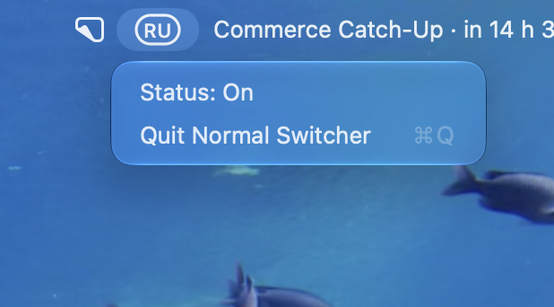

<table>
  <tr>
    <td width="132" valign="middle">
      
    </td>
    <td valign="middle">
      <h1>Normal Switcher</h1>
      <p>Your keyboard. Finally yours.<br>A tiny native macOS app that switches your keyboard language with a tap of Fn / 🌐.</p>
    </td>
  </tr>
</table>

<p align="center">
  
</p>

## Highlights

- One tap of **Fn / 🌐** selects the next enabled input source directly
- Fn combinations such as Fn + Delete and arrow keys keep working as combinations
- Current keyboard language in the menu bar, with codes such as EN, RU, FR, or DE
- Minimal system menu with **Status: On/Off** and **Quit Normal Switcher**
- A separate control window with a large native macOS switch and **Launch at login**
- Bottom-up confetti and “Your keyboard. Finally yours.” after a successful activation; respects Reduce Motion
- Optional launch at login through macOS Login Items
- Previous system Fn action restored when switching is disabled or the app quits normally
- Adaptive Icon Composer app icon; Apple Silicon native
- Local operation, with no accounts, telemetry, text logging, or background network service

## Requirements

- Apple Silicon Mac
- macOS 26 or newer
- Accessibility permission to handle Fn

## Install

Download [Normal-Switcher-1.1.4-macOS.zip](https://github.com/maaatheeew/Normal-Switcher/releases/download/v1.1.4/Normal-Switcher-1.1.4-macOS.zip), extract it, and move **Normal Switcher.app** to **Applications**.

Development builds are also available as ZIP artifacts from successful [Build and verify runs on main](https://github.com/maaatheeew/Normal-Switcher/actions/workflows/build.yml?query=branch%3Amain). GitHub requires sign-in to download workflow artifacts.

The app is **ad-hoc signed, not Apple-notarized**. Updating or rebuilding it may require granting Accessibility permission again.

## Use

1. Open **Normal Switcher** and click its language code in the menu bar.
2. Select **Status: On/Off** to open the controls, then turn on the large switch.
3. When prompted, allow Normal Switcher in **System Settings → Privacy & Security → Accessibility**. If the existing entry is enabled but access is not recognized, remove that app entry, add the installed copy again, and reopen the app.
4. Tap **Fn / 🌐** to switch languages. Enable **Launch at login** if desired.

Closing the control window keeps the app running in the menu bar. Select **Quit Normal Switcher** to exit. The menu and controls follow your macOS appearance.

Before taking control, the app checks access and starts its keyboard event monitors. It saves your current Fn action, sets the system action to **Do Nothing**, and selects input sources itself. Turning the switch off or quitting normally restores the saved action, including an originally absent preference. If you choose a different Fn action in System Settings while the app is active, that setting is preserved during restoration.

An interrupted run leaves a recovery snapshot for the next launch. Force-quitting or deleting the app cannot restore settings immediately. If Accessibility access is revoked while the app is running, it turns Fn handling off and attempts to restore the previous action. A failed settings operation is reported instead of silently treating it as successful.

## Build from source

Swift 6.2 or newer is required.

```bash
git clone https://github.com/maaatheeew/Normal-Switcher.git
cd Normal-Switcher
./scripts/test.sh
python3 scripts/build.py
open "dist/Normal Switcher.app"
```

The app and ZIP are written to `dist/`. Xcode's `actool` compiles `Resources/AppIcon.icon` into adaptive `Assets.car` renditions. A local build with Command Line Tools uses an `.icns` fallback. The GitHub Actions build requires the adaptive icon.

## Verification

`./scripts/test.sh` checks Fn taps and combinations, repeated presses, settings restoration and recovery, failed writes, manual settings changes, permission denial and delayed grants, unavailable event monitors, permission revocation, native-switch state rollback, menu/window wiring, confetti emission and cleanup, and exact system-indicator preference restoration.

Settings and permission regressions use isolated preferences, fake system settings, and fake event monitors. Menu/window checks inspect configuration and invoke actions directly. Confetti checks inspect the bottom emitter, animations, click-through behavior, and layer cleanup. These tests do not verify real clicks, visual alignment, particle trajectories, physical Fn delivery, or a real login after reboot.

The installed app also supports these explicit diagnostics:

```bash
"/Applications/Normal Switcher.app/Contents/MacOS/NormalSwitcher" --check-access
"/Applications/Normal Switcher.app/Contents/MacOS/NormalSwitcher" --verify-login-item
"/Applications/Normal Switcher.app/Contents/MacOS/NormalSwitcher" --verify-quit
```

Close the normal app before running diagnostics. The login-item check temporarily changes registration and restores its original state. The Quit check invokes the production Quit action in a separate process.

## Privacy and system integration

Normal Switcher observes Fn and modifier/key events to distinguish a standalone tap from a combination. It selects an input-source ID with Apple's Text Input Source API and does not log typed text. The menu bar code follows the selected input source; sources sharing a language can share a code, and the tooltip shows the full source name.

While Fn handling is enabled, Normal Switcher hides the system input-source indicator at the text cursor. Turning the switch off restores the exact previous global preference immediately, including an absent value or an already-disabled indicator, while the app keeps running. Permission loss and normal exit restore it too. Launching with Fn off leaves the indicator unchanged, apart from recovery of an interrupted previous run. A recovery snapshot survives an interrupted run; after a forced stop, restoration requires launching the app again. Manual preference changes made outside the app are preserved.

This follows the `TSMLanguageIndicatorEnabled` mechanism used by FnLangSwitch and refreshes the current user's `TextInputMenuAgent`. It uses an undocumented macOS preference, so visual behavior needs verification on the target OS. The app does not draw an indicator beside the mouse.

Fn-action control uses dynamically resolved private HIToolbox functions. If those functions are unavailable or a settings change cannot be verified, Fn handling stays off and an error is shown. A saved recovery snapshot is retained when restoration cannot be completed.

## Credits and license

Inspired by the problem and approach described in [tonku321/FnLangSwitch](https://github.com/tonku321/fn-lang-switcher). Normal Switcher is a separate implementation and does not redistribute that project's source or binary.

The celebration effect adapts [Kirchberg/Confetti](https://github.com/Kirchberg/Confetti) for macOS using AppKit and Core Animation. Copyright © 2023 Kostarev Kirill, [MIT License](ThirdParty/Confetti/LICENSE). The [adaptation notes](ThirdParty/Confetti/README.md) record the source revision and changes.

Normal Switcher is available under the [MIT License](LICENSE). Apple frameworks and SF Symbols belong to Apple.

[](https://star-history.com/#maaatheeew/Normal-Switcher&Date)
